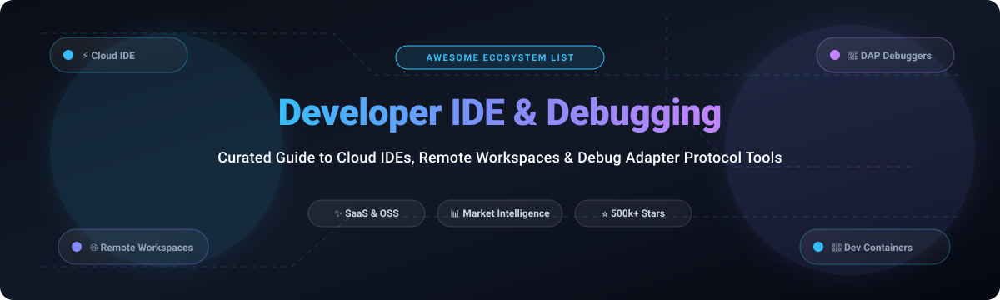

# ⚡ Awesome Developer IDE & Debugging 🛠️

**A Curated Catalog of Cloud Development Environments (CDEs), Web IDEs, Remote Workspaces & Debug Adapter Protocol (DAP) Tools**

  
  
  
  
  
  
  

*Empowering developers, platform architects, and DevOps teams with modern cloud IDEs, remote debugging protocols, and containerized dev environments.*

---

## 📑 Table of Contents
- [🔍 Sector Overview & Market Dynamics](#-sector-overview--market-dynamics)
- [☁️ SaaS / Hosted Platforms](#️-saas--hosted-platforms)
- [💻 Open-Source GitHub Projects](#-open-source-github-projects)
- [🏗️ Architectural Recommendations & Patterns](#️-architectural-recommendations--patterns)
- [📈 Star History](#-star-history)
- [🤝 How to Contribute](#-how-to-contribute)
- [💖 Support](#-support)
- [📜 Disclaimer](#-disclaimer)

---

## 🔍 Sector Overview & Market Dynamics

The global Cloud Development Environment (CDE) and Developer IDE ecosystem is estimated at **$4.8 billion in 2025–2026** and projected to surpass **$9.2 billion by 2030** (growing at a ~13.5% CAGR), driven by zero-trust remote engineering requirements, heavy enterprise onboarding friction, and AI-accelerated programming workflows. 

The market dynamics exhibit **moderate fragmentation transitioning toward concentrated ecosystems ("winner-take-most" dynamics)**: mega-cap hyperscalers (Microsoft with VS Code & GitHub Codespaces, Salesforce) control the predominant distribution and enterprise developer share, while specialized contenders (Replit, JetBrains, Gitpod, StackBlitz) aggressively capture specialized niches in collaborative sandboxing, instant web execution, and dedicated developer platform engineering.

---

## ☁️ SaaS / Hosted Platforms

Below is the comparative breakdown of prominent SaaS & hosted platforms, ordered by **Company Scale (Market Cap / Valuation / Annual Revenue)** in descending order:

| 🏷️ Product | 🏢 Company Scale (Valuation / Revenue) | 💳 Starting Paid Tier Pricing | 🎁 Free Tier Limit / Trial Duration | 📝 Description & Focus |
| :--- | :--- | :--- | :--- | :--- |
| **[Visual Studio Code Online](https://vscode.dev/)** | $3.1+ Trillion MCap (Microsoft) | $0.00 / month (Completely Free) | Unlimited free usage (100% free forever for browser-based code browsing & lightweight edits; compute requires bring-your-own-tunnel) | Web-native version of VS Code for fast repository exploration, web reviews, and client-side editing. |
| **[GitHub Codespaces](https://github.com/features/codespaces)** | ~$2.0 Billion ARR (GitHub / Microsoft) | $0.18 / hour (2-core compute) & $0.07 / GB-month storage | 60 core-hours and 15 GB storage per month free forever for personal GitHub accounts | Containerized ephemeral cloud development environments defined through `.devcontainer.json`. |
| **[Salesforce Developer Console](https://developer.salesforce.com/)** | $280+ Billion MCap (~$38B ARR) | $25.00 / user / month (Salesforce Starter Suite) | Free forever Salesforce Developer Edition org (2 developer licenses, 5 MB data storage, 20 MB file storage) | Embedded browser IDE with Apex interactive debugger, SOQL queries, and execution logging. |
| **[JetBrains Fleet](https://www.jetbrains.com/fleet/)** | ~$500 Million ARR (JetBrains) | $10.00 / user / month (or included with All Products Pack) | Free forever during public preview period with full access to distributed editing and basic smart mode | Distributed, next-generation lightweight IDE built with polyglot smart completion and remote backends. |
| **[Replit](https://replit.com/)** | $3.0 Billion Valuation (~$50M ARR) | $25.00 / month (or $20/mo billed annually for Replit Core) | Free forever Starter plan: Public Repls only, 0.5 vCPU, 512 MB RAM, and basic Replit AI completions | Instant collaborative cloud browser workspace, rapid hosting, and AI software generation. |
| **[Sourcegraph](https://sourcegraph.com/)** | $2.6 Billion Valuation (~$60M ARR) | $9.00 / user / month (Cody Pro) | Free forever Cody plan: 500 autocomplete suggestions & 20 chat/commands per month | Universal code intelligence, semantic cross-repo search, batch changes, and deep code context. |
| **[StackBlitz](https://stackblitz.com/)** | $700+ Million Valuation (~$20M ARR) | $10.00 / user / month (billed annually for Pro Plan) | Free forever Community plan: Unlimited public projects, in-browser Node.js WebContainers, and public previews | Zero-latency WebContainer technology running full Node.js runtimes securely within client browsers. |
| **[Gitpod](https://www.gitpod.io/)** | $350+ Million Valuation (~$15M ARR) | $9.00 / user / month (Pay-As-You-Go with team flex credits) | 50 hours per month free forever for personal accounts with 4 parallel ephemeral workspaces | Automated zero-setup ephemeral dev environments integrated with GitHub, GitLab, and Bitbucket. |
| **[Codeanywhere](https://codeanywhere.com/)** | ~$10 Million Valuation (~$3M ARR) | $8.00 / user / month (Starter Plan billed annually) | 7-day free trial on paid plans with 1 container workspace, 2 GB RAM, and standard SSH access | Cloud IDE with multi-language runtime templates, containerized devboxes, and terminal collaboration. |

---

## 💻 Open-Source GitHub Projects

The leading open-source repositories for self-hosting cloud IDEs, custom developer environments, and debuggers, sorted by **GitHub_Stars (Descending)**:

| 📦 Repository | ⭐ GitHub_Stars | ⚖️ License | 📝 Overview & Core Features |
| :--- | :---: | :---: | :--- |
| **[microsoft/vscode](https://github.com/microsoft/vscode)** |  | MIT | De-facto industry standard extensible code editor and IDE platform with native DAP and LSP support. |
| **[neovim/neovim](https://github.com/neovim/neovim)** |  | Apache-2.0 | Modern, hyperextensible Vim-fork featuring asynchronous plugins, embedded Lua, and built-in LSP/DAP. |
| **[zed-industries/zed](https://github.com/zed-industries/zed)** |  | GPL-3.0 / AGPL-3.0 | High-performance, GPU-accelerated multiplayer code editor crafted in Rust with remote execution. |
| **[coder/code-server](https://github.com/coder/code-server)** |  | MIT | Run VS Code on any remote Linux/macOS/cloud server and interact through any modern web browser. |
| **[daytonaio/daytona](https://github.com/daytonaio/daytona)** |  | Apache-2.0 | Autonomous open-source dev environment manager that provisions standardized development environments with one command. |
| **[helix-editor/helix](https://github.com/helix-editor/helix)** |  | MPL-2.0 | Post-modern modal text editor in Rust with built-in Tree-sitter syntax highlighting, LSP, and DAP debugging. |
| **[mitmproxy/mitmproxy](https://github.com/mitmproxy/mitmproxy)** |  | MIT | Interactive TLS-capable intercepting HTTP/HTTPS reverse proxy with Python scripting for network debugging. |
| **[lapce/lapce](https://github.com/lapce/lapce)** |  | Apache-2.0 | Lightning-fast native desktop and remote GUI code editor written in Rust with Rope science and WASI plugins. |
| **[go-delve/delve](https://github.com/go-delve/delve)** |  | MIT | Standard source-level debugger for the Go programming language with full goroutine state introspection. |
| **[eclipse-theia/theia](https://github.com/eclipse-theia/theia)** |  | EPL-2.0 | Extensible cloud & desktop IDE framework supporting full VS Code extensions, powering Google Cloud Shell and Arduino IDE 2.x. |
| **[liriliri/eruda](https://github.com/liriliri/eruda)** |  | MIT | Feature-packed DevTools console, network inspector, and elements tree for mobile and embedded web browsers. |
| **[rust-lang/rust-analyzer](https://github.com/rust-lang/rust-analyzer)** |  | Apache-2.0 / MIT | Modular compiler frontend and Language Server Protocol implementation providing rich IDE features for Rust. |
| **[loft-sh/devpod](https://github.com/loft-sh/devpod)** |  | MPL-2.0 | Client-only, unopinionated Codespaces alternative; spins up dev environments across local Docker, K8s, or any cloud VM. |
| **[gitpod-io/gitpod](https://github.com/gitpod-io/gitpod)** |  | AGPL-3.0 | Automated cloud development environment platform orchestrating ephemeral Kubernetes developer workspaces. |
| **[mfussenegger/nvim-dap](https://github.com/mfussenegger/nvim-dap)** |  | GPL-3.0 | Debug Adapter Protocol (DAP) client implementation for Neovim; configure breakpoints, stepping, and repls. |
| **[gitpod-io/openvscode-server](https://github.com/gitpod-io/openvscode-server)** |  | MIT | Upstream-aligned server running VS Code in a browser with standard web assets and minimal upstream divergence. |
| **[CocoaDebug/CocoaDebug](https://github.com/CocoaDebug/CocoaDebug)** |  | MIT | Comprehensive in-app iOS debugging tool for intercepting network requests, console logs, and memory performance. |
| **[epasveer/seer](https://github.com/epasveer/seer)** |  | GPL-3.0 | Intuitive Qt GUI frontend for GDB, enabling graphical visualization of memory, assembly, and C/C++ threads. |
| **[vadimcn/codelldb](https://github.com/vadimcn/codelldb)** |  | MIT | High-performance DAP debugger extension for VS Code targeting C++, Rust, and native binaries via LLDB. |
| **[rohanrhu/gdb-frontend](https://github.com/rohanrhu/gdb-frontend)** |  | MIT | Web-based, flexible, and extensible GUI debugger client for GDB with real-time remote inspection. |
| **[microsoft/debugpy](https://github.com/microsoft/debugpy)** |  | MIT | Official Python implementation of the Debug Adapter Protocol used in VS Code and remote Python debug runtimes. |
| **[microsoft/vscode-js-debug](https://github.com/microsoft/vscode-js-debug)** |  | MIT | Modern DAP-compliant JavaScript, Node.js, and TypeScript debugger engine bundled within Visual Studio Code. |
| **[alexmojaki/snoop](https://github.com/alexmojaki/snoop)** |  | MIT | Intuitive Python debugging toolkit built on PySnooper with detailed local variable logging and recursion analysis. |
| **[pocco81/dap-buddy.nvim](https://github.com/pocco81/dap-buddy.nvim)** |  | MIT | Manager and automated installer for Debug Adapter Protocol servers within Neovim environments. |
| **[NemophilistJohn/BOBOcloud-A-cloud-based-remote-compilation-platform](https://github.com/NemophilistJohn/BOBOcloud-A-cloud-based-remote-compilation-platform)** |  | MIT | Distributed cloud compiler backend with Language Server Protocol (LSP) and DAP remote debugging services. |
| **[cifkao/nopdb](https://github.com/cifkao/nopdb)** |  | MIT | Non-interactive Python debugging tool executing custom inspection actions without stopping process execution. |
| **[ploomber/ploomber-engine](https://github.com/ploomber/ploomber-engine)** |  | Apache-2.0 | Execution, testing, and debugging engine tailored for Jupyter notebooks with cell-level profiling. |
| **[viewizard/dncdbg](https://github.com/viewizard/dncdbg)** |  | MIT | Lightweight managed-code DAP debugger for .NET Core with minimal ~11 MB memory consumption. |
| **[davidebianchi03/codebox](https://github.com/davidebianchi03/codebox)** |  | GPL-3.0 | Self-hosted provider of distributed development workspaces powered by Docker Compose and remote SSH. |
| **[Howryann/open-devbox](https://github.com/Howryann/open-devbox)** |  | MIT | Portable Docker container devbox with preconfigured SSH keys and Mutagen bidirectional synchronization. |
| **[orchard-cde/orchard](https://github.com/orchard-cde/orchard)** |  | Apache-2.0 | Devcontainer-native VM-isolated cloud dev environment platform accompanied by Canopy web administration. |
| **[KrishJani/Scalable-Multi-Language-IDE](https://github.com/KrishJani/Scalable-Multi-Language-IDE)** |  | MIT | Web-based multi-language code editor utilizing Monaco Editor and containerized execution limits. |
| **[munna-yadav/Cloud-IDE](https://github.com/munna-yadav/Cloud-IDE)** |  | MIT | Collaborative cloud IDE inspired by VS Code using React, TypeScript, Monaco, and Docker runtimes. |

---

## 🏗️ Architectural Recommendations & Patterns

For engineering teams evaluating or constructing self-hosted cloud IDE platforms:
- **Presentation & Web Frontends**: Pair **[code-server](https://github.com/coder/code-server)** or **[OpenVSCode Server](https://github.com/gitpod-io/openvscode-server)** with a reverse-proxy (e.g., Traefik/Nginx) for direct browser-based accessibility.
- **Environment Orchestration**: Utilize **[DevPod](https://github.com/loft-sh/devpod)** or **[Daytona](https://github.com/daytonaio/daytona)** to provision reproducible, ephemeral container environments on any Kubernetes cluster or cloud infrastructure.
- **Debugging & Protocol Layer**: Standardize on **Debug Adapter Protocol (DAP)** compatible debuggers (**[delve](https://github.com/go-delve/delve)** for Go, **[debugpy](https://github.com/microsoft/debugpy)** for Python, **[codelldb](https://github.com/vadimcn/codelldb)** for C++/Rust, **[vscode-js-debug](https://github.com/microsoft/vscode-js-debug)** for JS/TS) to decouple your IDE choice from runtime tooling.

---

## 📈 Star History

---

## 🤝 How to Contribute

Contributions are wholeheartedly welcome! Here is how you can help expand this resource:
1. 🍴 Fork the repository.
2. 🌿 Create your feature branch (`git checkout -b feature/add-new-tool`).
3. 📝 Add entries to `README.md` keeping tabular format and factual information intact.
4. 🚀 Commit your modifications (`git commit -m "Add new IDE/debugging tool"`).
5. 📤 Push to the branch and open a Pull Request.

---

## 💖 Support

Thank you for exploring and utilizing **Awesome-Developer-IDE-Debugging**! 🌟

If this repository assisted you in selecting or building cloud developer environments and debugging stacks, please consider:
- ⭐ **Starring** the repository to boost visibility
- 🍴 **Forking** and contributing new tools or corrections
- 📢 **Sharing** with your developer team and engineering networks
- ☕ **Buying a coffee / sponsoring** the maintainer on the [GitHub Sponsor Dashboard](https://github.com/sponsors/ishandutta2007)

---

## 📜 Disclaimer

- This list is community-curated for informational and architectural evaluation purposes.
- Mentions do not constitute commercial endorsement.
- Verify security, data governance (GDPR, SOC 2, HIPAA), and secret management protocols before deploying cloud development environments inside corporate infrastructure.
